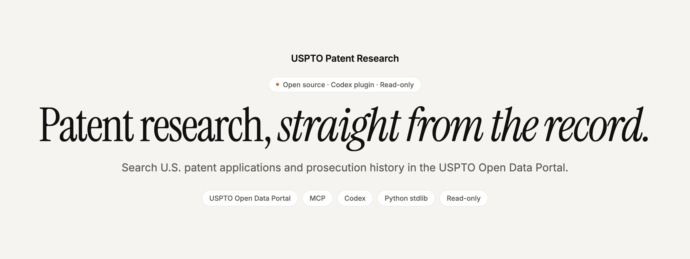
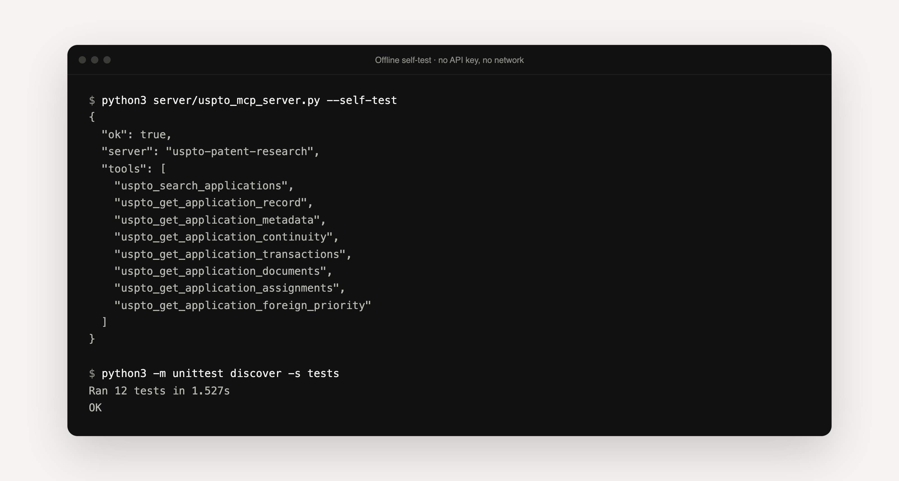

<p align="center">
  <picture>
    <source media="(prefers-color-scheme: dark)" srcset=".github/assets/banner-dark.png">
    
  </picture>
</p>

<p align="center">
  <strong>Ask Codex about U.S. patent applications. It reads the record and changes nothing.</strong><br>
  A read-only plugin that pairs eight USPTO Open Data Portal tools with a patent-research skill, so Codex can search public applications, follow prosecution history and organise evidence.
</p>

<p align="center">
  <a href="#install"><strong>Install</strong></a> ·
  <a href="#the-eight-tools"><strong>Tools</strong></a> ·
  <a href="plugins/uspto-patent-research/skills/uspto-patent-research/references/patent-workflow.md"><strong>Research workflow</strong></a> ·
  <a href="PRIVACY.md"><strong>Privacy</strong></a> ·
  <a href="CONTRIBUTING.md"><strong>Contribute</strong></a>
</p>

<p align="center">
  <a href="LICENSE"></a>
  
  
  <a href="https://github.com/mihirkavi/uspto-patent-research-plugin/actions/workflows/ci.yml"></a>
</p>

> [!IMPORTANT]
> This is an independent research tool, not an official USPTO product and not legal advice. It does not determine patentability, infringement, validity, or freedom to operate. Have a registered patent practitioner review work before relying on it or filing.

<p align="center">
  
  <br><sub>The server's real offline self-test and test suite. Neither needs an API key or the network.</sub>
</p>

## Why USPTO Patent Research

Early patent work means digging through application records: what was filed, how it is related to earlier filings, what the examiner said, and who owns it now. The USPTO publishes all of that through its Open Data Portal, but reading it by hand is slow.

**This plugin lets Codex do the digging for you, safely.** It searches public Patent File Wrapper records, reads metadata, continuity, transactions, documents and assignments, and then uses a structured skill to turn findings into prior-art landscapes, claim-element matrices and draft disclosures. It can only read.

<table>
  <tr>
    <td width="33%" valign="top">
      <h3>🔒 Read-only by design</h3>
      Only HTTP <code>GET</code> requests to <code>api.uspto.gov</code>, with redirects pinned to that host. No filing, payment, signing or account tools exist.
    </td>
    <td width="33%" valign="top">
      <h3>📂 The whole file wrapper</h3>
      Search, metadata, continuity, foreign priority, prosecution transactions, document lists and recorded assignments.
    </td>
    <td width="33%" valign="top">
      <h3>🧩 Zero dependencies</h3>
      One Python 3.10+ file using only the standard library. Your API key stays in your local environment.
    </td>
  </tr>
</table>

## The eight tools

| Tool | What it reads |
| --- | --- |
| `uspto_search_applications` | Search application records with ODP query syntax |
| `uspto_get_application_record` | A complete public application record |
| `uspto_get_application_metadata` | Bibliographic and status metadata |
| `uspto_get_application_continuity` | Domestic continuity data |
| `uspto_get_application_transactions` | Prosecution transaction history |
| `uspto_get_application_documents` | The public file-wrapper document list |
| `uspto_get_application_assignments` | Recorded assignment data |
| `uspto_get_application_foreign_priority` | Foreign-priority data |

The bundled skill adds the research method: [patent workflow](plugins/uspto-patent-research/skills/uspto-patent-research/references/patent-workflow.md), [ODP API notes](plugins/uspto-patent-research/skills/uspto-patent-research/references/odp-api.md) and [setup](plugins/uspto-patent-research/skills/uspto-patent-research/references/setup.md).

## Install

You need Codex with plugin support, Python 3.10 or newer, and a USPTO.gov account with ODP access and an API key from the [USPTO getting-started page](https://data.uspto.gov/apis/getting-started).

```bash
codex plugin marketplace add mihirkavi/uspto-patent-research-plugin
codex plugin add uspto-patent-research@patent-research
```

Make the key available as `USPTO_ODP_API_KEY` before starting Codex. On macOS with zsh, this hidden prompt keeps the key out of your shell history:

```zsh
read -s "USPTO_ODP_API_KEY?USPTO ODP API key: "
export USPTO_ODP_API_KEY
printf '\n'
```

With bash on Linux, use `read -rsp "USPTO ODP API key: " USPTO_ODP_API_KEY`, then the same `export` and `printf`. Restart Codex, open a new task and check `/mcp` for `uspto_research`. Then try:

```text
Use $uspto-patent-research to search USPTO records for prior art related to adaptive meal nutrition estimation.
```

For a persistent setup, use a secure local environment or your operating system's credential store. Never commit the key, paste it into prompts or add it to plugin files.

## Verify a checkout

```bash
python3 -m unittest discover -s plugins/uspto-patent-research/tests -v
python3 plugins/uspto-patent-research/server/uspto_mcp_server.py --self-test
```

The offline suite checks packaging, JSON-RPC behaviour, tool schemas, input validation, error handling and request construction without a credential. It proves the plugin is wired correctly, not that your account currently has live ODP access. With `USPTO_ODP_API_KEY` set, check live access with:

```bash
python3 plugins/uspto-patent-research/server/uspto_mcp_server.py \
  --search 'applicationMetaData.patentNumber:10049598' --limit 1
```

<details>
<summary><strong>Repository layout</strong></summary>
<br>

```text
.agents/plugins/marketplace.json       Public Codex marketplace catalog
plugins/uspto-patent-research/
├── .codex-plugin/plugin.json          Plugin manifest
├── .mcp.json                          Local STDIO MCP registration
├── server/uspto_mcp_server.py         Dependency-free read-only server
├── skills/uspto-patent-research/      Research workflow and references
└── tests/                             Offline behaviour and packaging tests
assets/brand/                          Conceptual project artwork
```

</details>

## Honest status

Version 1.0.0 of the plugin is complete for what it does, but it is deliberately narrow:

- **Codex only.** The repository ships a Codex manifest. The server speaks plain stdio MCP, so other clients may be able to run it, but that is not packaged or tested.
- **A key is required for real data.** ODP access needs a current USPTO account and API key, and USPTO account rules and rate limits can change. The screenshot above shows the offline self-test because it needs no key.
- **Not a complete prior-art search.** ODP metadata and file-wrapper records leave out full-text patent sources, non-patent literature and citation networks, and professional judgment remains necessary.
- It does not download document contents, search other patent offices, file applications, pay fees or modify USPTO records.
- It runs locally over stdio. Browser-only environments would need a separately hosted, authenticated MCP service, which this repository does not provide.

See [PRIVACY.md](PRIVACY.md), [SECURITY.md](SECURITY.md) and [CONTRIBUTING.md](CONTRIBUTING.md) for public-use details.

## License

[MIT](LICENSE)

<!-- project-artwork:start -->
## Project artwork


<sub>Conceptual project artwork, not a product screenshot. [Asset files, design notes, and generation prompts](assets/brand/README.md).</sub>
<!-- project-artwork:end -->

<p align="center">
  <br>
  <sub><strong>USPTO Patent Research</strong> · Read the record, change nothing.</sub>
</p>
